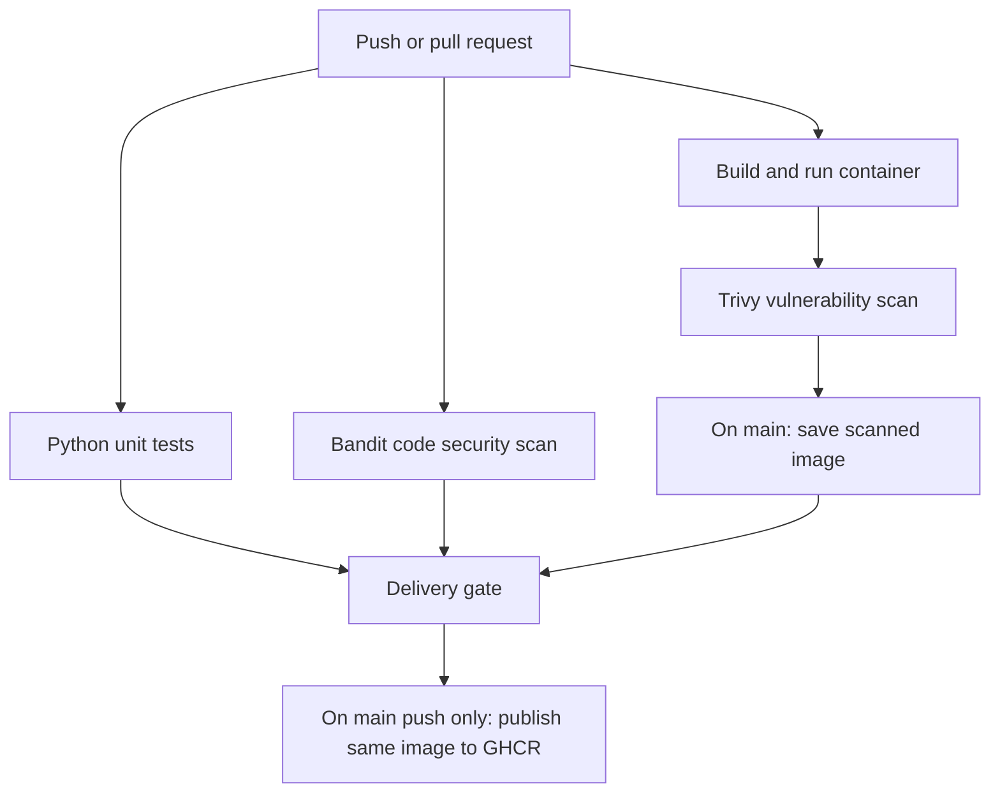

# GitHub DevSecOps Lab 03 — Secure CI/CD Pipeline Engineering with GitHub Actions

[](https://github.com/SkynetAI-Labs/lab-03-secure-cicd-pipeline/actions/workflows/ci.yml)

A hands-on DevSecOps project by **SkynetAI-Labs**, demonstrating automated testing, security scanning, protected pull requests, and controlled container delivery.

---

## Project Objective

Build a pipeline that checks application code and container dependencies before publishing a container image. Demonstrate both a blocked security check and successful recovery.

The application is deliberately small: a Python function returns a health status. The focus is pipeline engineering rather than application complexity.

## Pipeline Architecture



Pull requests run the tests and security scans without publishing. On pushes to `main`, delivery waits for all three check jobs to succeed.

## Tools and Technologies

- **GitHub Actions** — CI and container delivery
- **Python 3.12 / unittest** — application and automated testing
- **Bandit** — Python security analysis
- **Docker** — container build and execution
- **Python Alpine** — container base image
- **Trivy** — container vulnerability scanning
- **GitHub Container Registry (GHCR)** — container image publishing
- **Ubuntu / WSL** — local development environment

## Security Controls

| Control | Implementation |
|---|---|
| Protected main branch | Pull requests, up-to-date branches, and passing unit, code security, container, and Gitleaks checks required |
| Administrator enforcement | Branch protection configured to prevent bypassing |
| Action version integrity | Direct workflow action references pinned to full commit SHAs |
| Limited permissions | Read-only repository access by default; package, attestation, and OIDC write permissions limited to main-only delivery |
| Checkout credentials | Credential persistence disabled |
| Container execution | Application runs as an unprivileged user |
| Vulnerability policy | Trivy fails on HIGH or CRITICAL findings, including unfixed findings |
| Delivery gate | Publishing depends on successful tests, Bandit, and container scanning |
| Image continuity | Delivery loads and publishes the scanned image without rebuilding |
| Image identification | Published images tagged with the Git commit SHA |
| Authentication | GitHub supplies the workflow credential; no manually managed registry token |
| Artifact retention | Scanned image transfer artifact retained for one day |

## Validation Evidence

### 1. Unsafe Code Detection and Recovery

An isolated demonstration branch introduced an unsafe `eval()` call without executing it.

Bandit reported **B307**, with medium severity and high confidence, causing the security job to fail.

- [Expected security failure](https://github.com/SkynetAI-Labs/lab-03-secure-cicd-pipeline/actions/runs/39068127558)
- [Successful run after removing the unsafe example](https://github.com/SkynetAI-Labs/lab-03-secure-cicd-pipeline/actions/runs/39068386964)

The unsafe example was removed from the demonstration branch and was not merged into `main`.

### 2. Container Vulnerability Remediation

The initial Debian-based image scan reported **44 HIGH findings**.

Remediation included:

1. Replacing the Debian-based container image with Python Alpine.
2. Applying available Alpine package updates.
3. Retaining the existing vulnerability failure policy.
4. Rebuilding and rescanning the container.

The revised image passed the checks.

- [Container build and remediation pull request](https://github.com/SkynetAI-Labs/lab-03-secure-cicd-pipeline/pull/2)

### 3. Controlled Container Delivery

The main-branch workflow successfully completed:

- Python unit tests
- Bandit security analysis
- Docker build and execution
- Trivy vulnerability scanning
- Gated image publishing to GHCR

Evidence:

- [Successful delivery run](https://github.com/SkynetAI-Labs/lab-03-secure-cicd-pipeline/actions/runs/39071760350)
- [Delivery implementation](https://github.com/SkynetAI-Labs/lab-03-secure-cicd-pipeline/pull/3)
- [Action and runner maintenance](https://github.com/SkynetAI-Labs/lab-03-secure-cicd-pipeline/pull/4)

## Run the Tests Locally

From the repository root:

```bash
python3 -m unittest discover -s tests -v
```

## Build and Run Locally

These commands require a running Docker engine.

```bash
docker build --pull -t secure-cicd-demo:local .
docker run --rm secure-cicd-demo:local
```

The container prints its health status and exits. It does not run a web server.

## Published Container Image

```text
ghcr.io/skynetai-labs/secure-cicd-pipeline-github-actions:<full-commit-sha>
```

Replace the tag with the full `main` branch commit SHA from a successful delivery run.

Registry access depends on the package's visibility and permissions.

## Repository Structure

```text
lab-03-secure-cicd-pipeline/
├── .github/
│   └── workflows/
│       ├── ci.yml
│       └── gitleaks.yml
├── app/
│   └── health.py
├── tests/
│   └── test_health.py
├── Dockerfile
├── .dockerignore
├── .gitignore
├── skynet-lab-03.png
└── README.md
```

## Scope and Limitations

This lab demonstrates continuous integration and container delivery to a registry. It does **not** deploy an application to a live environment.

A passing vulnerability scan means no findings matched the configured failure policy at scan time. It does not guarantee that an image is free of vulnerabilities.

Lower-severity vulnerabilities do not fail the container job.

Action pins, scanner versions, base images, and vulnerability findings require ongoing maintenance. The base image is pinned by SHA-256 OCI index digest. Updates are manual and require reviewed pull requests and rescanning. Alpine packages are upgraded during builds, so the complete build is not fully reproducible.

## Skills Demonstrated

- Secure CI/CD pipeline engineering
- GitHub Actions workflow design
- Python automated testing
- Static application security testing
- Container vulnerability scanning
- Docker container hardening
- Vulnerability remediation
- GitHub branch protection
- Pull request security workflows
- Least-privilege permissions
- Gated container image delivery
- GHCR integration

---

**Organisation:** SkynetAI-Labs  
**Portfolio:** GitHub DevSecOps Labs  
**Project:** Lab 03 — Secure CI/CD Pipeline Engineering

Part of the [SkynetAI-Labs GitHub portfolio](https://github.com/SkynetAI-Labs).

## Supply-Chain Security Evidence

- Base image pinned to a verified multi-platform SHA-256 digest: [PR #12](https://github.com/SkynetAI-Labs/lab-03-secure-cicd-pipeline/pull/12).
- CycloneDX SBOM generated from the scanned image, checked for container metadata and Alpine package inventory, and uploaded for 30 days: [PR #13](https://github.com/SkynetAI-Labs/lab-03-secure-cicd-pipeline/pull/13).
- Signed provenance generated for the published registry digest and uploaded to GitHub and GHCR: [PR #14](https://github.com/SkynetAI-Labs/lab-03-secure-cicd-pipeline/pull/14).
- Gitleaks archive checked against a pinned SHA-256 before extraction and installation: [PR #15](https://github.com/SkynetAI-Labs/lab-03-secure-cicd-pipeline/pull/15).

Independent GitHub CLI attestation verification succeeded on 24 October 2026 for image digest:
`sha256:d7254f216a0811d71a203be08d751c2ecb23dc8d6b437af2b9a50d954e30c76c`

Verification enforced the expected repository, the exact ci.yml workflow on main, GitHub's OIDC issuer, GitHub-hosted runners and SLSA provenance v1.

[Verified attestation](https://github.com/SkynetAI-Labs/lab-03-secure-cicd-pipeline/attestations/59317462)

[Post-merge CI and publishing evidence](https://github.com/SkynetAI-Labs/lab-03-secure-cicd-pipeline/actions/runs/40054481052)

[Post-merge Gitleaks checksum and scan evidence](https://github.com/SkynetAI-Labs/lab-03-secure-cicd-pipeline/actions/runs/40054481151)

### Additional Limitations

- SBOM content checks are not full CycloneDX schema validation.
- Provenance verification establishes artifact identity and signed workflow claims; it does not prove application security or a particular SLSA assurance level.
- The independently verified digest above identifies one historical image. Later images require separate verification.
- Provenance generation follows publication; consumers should verify attestations before trusting images.
- Branch protection requires PRs and four passing checks, but requires zero approving reviews.
- Gitleaks is a separate required PR check. The publishing job directly waits on tests, Bandit and container checks, rather than the separate Gitleaks workflow.
- Base images, action pins and scanner versions need manual maintenance. No automatic updater is configured.
- Direct action SHA pins do not imply all transitive tools are checksum-pinned. Bandit's pip dependencies are not hash-locked.


## Repository audit — 24 October 2026

See the [dated security audit and prioritised recommendations](SECURITY_AUDIT.md) for the reviewed source commit, verification results, open findings and evidence limitations.

